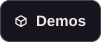
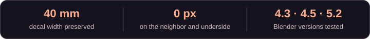

<div align="center">


<p> <a href="README.ru.md"></a></p>

<p><strong>Edit your open Blender scene from Codex or Claude Code. Verify changes with camera renders and pixel comparisons.</strong></p>

<p><a href="#install"></a> <a href="#demos"></a> <a href="#verification"></a></p>

</div>

<a id="install"></a>
## Quick start

Install **Blender 4.3+**, **Python 3.11+**, and your MCP client. Close Blender if it's open, then run these commands in a terminal.

```sh
git clone https://github.com/msFoma/foma-scene.git
cd foma-scene
python scripts/setup_scene.py --client codex
```

For Claude Code, use `--client claude`. On Windows you can use `py -3` in place of `python`. Setup creates a local Python environment, installs and enables the Blender add-on, pairs the bridge, and registers `foma-scene` with your client.

Open Blender. In the 3D Viewport press **N**, open **Blender MCP**, and click **Connect**. Start a fresh session in your MCP client.

<details>
<summary>Blender path, both clients, and connection help</summary>

- If Blender is installed elsewhere, add `--blender "/path/to/blender"`.
- To register both clients, use `--client codex --client claude`. Run setup without `--client` to print the registration commands without changing client settings.
- If you've edited the token or port in Blender, run setup again to sync the local MCP configuration. Keep the checkout at the same path because the client registration uses absolute paths.
- For a custom installation or Streamable HTTP, see the [connection guide](docs/guide.md#connect-an-open-blender-session).

</details>

### Try it in a blank scene

> Use Foma Scene to create a gear train with 18, 30 and 54 teeth. Show the transmission ratio and return a camera render.

For reusable workflows, see the [agent skill](skills/blender-mcp/SKILL.md) and [tool reference](docs/guide.md#tools-and-semantics).

<div align="center">

 

<sub>Pixel illustrations · gear assembly and decal inspection</sub>

</div>

## What you get

| Live Blender | Scoped edits |
| --- | --- |
| Inspect the active object and receive actual camera renders or a viewport image. | Place and move editable decals in millimeters, run supported add-on operators, and build animated gear trains. |
| **Visual checks** | **Recovery and export** |
| Compare retained before and after frames. Set tolerances per region and verify protected views without another render. | Recover a job after a client disconnect, roll back recent edits, and reimport an exported GLB for inspection. |

<a id="demos"></a>
## Demos

### Animated 3:1 gear train


Created with `create_gear_train` and rendered with `observe`. The saved scene was reopened in Blender, where one input turn advanced the output by **120° in the same direction**.

<details>
<summary>See the evidence from a scoped decal edit</summary>


Both lids started with a shared material. Foma Scene added a **40 mm** logo to one lid and moved it **3 mm** along local X. The neighbor and the underside registered **zero changed pixels**. The overlay came from `verify_edit`, using the retained camera frames.

</details>

<a id="verification"></a>
## Verification



| Check | Observed result |
| --- | --- |
| Blender | Acceptance passed on **4.3.2**, **4.5.5 LTS** and **5.2.3 LTS**, including a GUI run on 5.2.3. |
| Transport | The same tool catalog returned camera images over **stdio** and **Streamable HTTP**. |
| Verification speed | On the lid fixture, two cached overlays arrived in **133 ms**. Rendering the same two views again took **2.52 s**. |
| Large scene | A detailed page of 200 instances in a 5,000-object scene fell from **2.10 s to 94 ms** median. |
| Client status | Codex app-server received a Blender PNG and Claude Code connected to MCP. Model-backed tests still require authenticated sessions. |

```sh
python tests/smoke.py
python tests/scalability.py
```

[Reproduce the acceptance runs](docs/guide.md#run-the-wider-acceptance-check) · [Read the test evidence](docs/guide.md#verification-on-25-november-2026)
