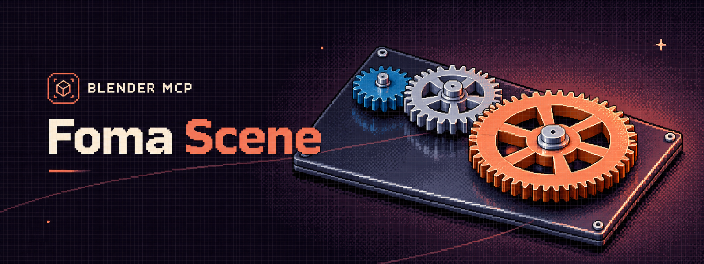
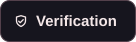
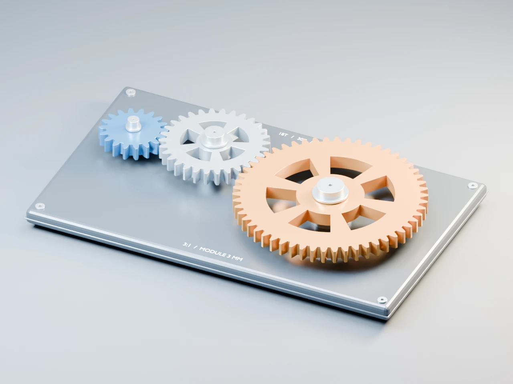
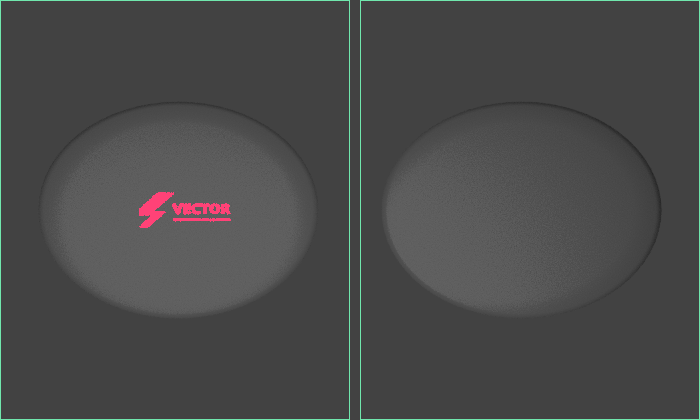

<div align="center">



<p> <a href="README.ru.md"></a></p>

<p><strong>Blender MCP for editing a live scene and verifying the result.</strong></p>

<p><a href="#install"></a> <a href="#demos"></a> <a href="#verification"></a></p>


</div>

## What you get

| Live Blender | Scoped edits |
| --- | --- |
| Inspect the active object and receive actual camera renders or a viewport image. | Place and move editable decals in millimeters, run supported add-on operators, and build animated gear trains. |
| **Visual checks** | **Recovery and export** |
| Compare retained before and after frames. Set tolerances per region and verify protected views without another render. | Recover a job after a client disconnect, roll back recent edits, and reimport an exported GLB for inspection. |

<a id="demos"></a>
## Demos

### Animated 3:1 gear train



Created with `create_gear_train` and rendered with `observe`. The saved scene was reopened in Blender, where one input turn advanced the output by **120° in the same direction**.

<details>
<summary>See the evidence from a scoped decal edit</summary>



Both lids started with a shared material. Foma Scene added a **40 mm** logo to one lid and moved it **3 mm** along local X. The neighbor and the underside registered **zero changed pixels**. The overlay came from `verify_edit`, using the retained camera frames.

</details>

<a id="install"></a>
## Install

Use **Python 3.11+** and **Blender 4.3+**. From the project root, install the MCP server and build the add-on ZIP.

```sh
python -m pip install -e .
mkdir -p work
python -m zipfile -c work/blender-bridge.zip blender_bridge
```

1. In Blender, use **Edit → Preferences → Add-ons → Install from Disk**, select `work/blender-bridge.zip` and enable **Foma Scene · Blender MCP**.
2. Set a bridge token of at least 16 characters in the add-on preferences. In the 3D Viewport, open the **Blender MCP** sidebar and click **Connect**.
3. Set the same `BLENDER_MCP_TOKEN` in the terminal that starts the external server. Keep it in your local environment.

```sh
python -m blender_mcp.server --transport streamable-http --port 8766
```

Register the running local server with your client.

```sh
claude mcp add --transport http blender http://127.0.0.1:8766/mcp
codex mcp add blender --url http://127.0.0.1:8766/mcp
```

[Connection guide for stdio, custom ports and authentication](docs/guide.md#connect-an-open-blender-session) · [Tool reference](docs/guide.md#tools-and-semantics)

### Try one request

Open a blank Blender scene and use the [`blender-mcp` skill](skills/blender-mcp/SKILL.md) in Codex or Claude Code.

> Use Blender MCP to create a gear train with 18, 30 and 54 teeth. Show the transmission ratio and return a camera render.

`inspect_scene` gives the agent a scene token, `create_gear_train` adds the mechanism, and `observe` returns the Blender render.

<a id="verification"></a>
## Verification

| Check | Observed result |
| --- | --- |
| Blender | Acceptance passed on **4.3.2**, **4.5.5 LTS** and **5.2.3 LTS**, including a GUI run on 5.2.3. |
| Transport | The same tool catalog returned camera images over **stdio** and **Streamable HTTP**. |
| Verification speed | On the lid fixture, two cached overlays arrived in **133 ms**. Rendering the same two views again took **2.52 s**. |
| Large scene | A detailed page of 200 instances in a 5,000-object scene fell from **2.10 s to 94 ms** median. |
| Client status | Codex app-server received a Blender PNG and Claude Code connected to MCP. Model-backed tests still require authenticated sessions. |

```sh
python tests/smoke.py
python tests/scalability.py
```

[Reproduce the acceptance runs](docs/guide.md#run-the-wider-acceptance-check) · [Read the test evidence](docs/guide.md#verification-on-25-november-2026)
