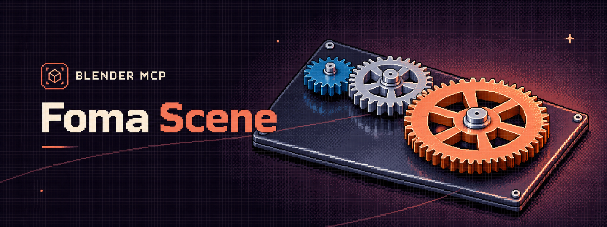
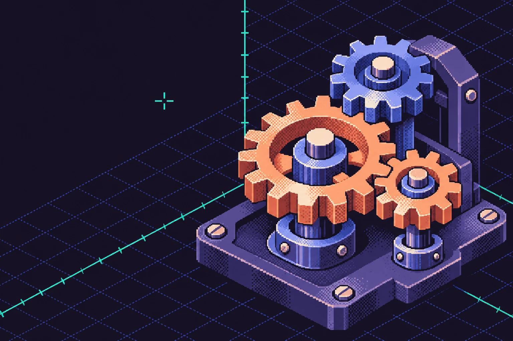
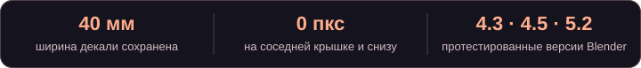

<div align="center">



<p><a href="README.md"></a> </p>

<p><strong>Редактируйте открытую сцену Blender из Codex или Claude Code и проверяйте правки по рендерам и пиксельным сравнениям.</strong></p>

<p><a href="#install"></a> <a href="#demos"></a> <a href="#verification"></a></p>

</div>

<a id="install"></a>
## Быстрый старт

Понадобятся **Blender 4.3+**, **Python 3.11+** и установленный MCP-клиент. Закройте Blender, если он открыт, и выполните команды в терминале.

```sh
git clone https://github.com/msFoma/foma-scene.git
cd foma-scene
python scripts/setup_scene.py --client codex
```

Для Claude Code укажите `--client claude`. В Windows можно вызвать `py -3` вместо `python`. Скрипт создаст локальное окружение Python, установит и включит аддон, настроит подключение к Blender и добавит сервер `foma-scene` в клиент.

Откройте Blender. В окне 3D Viewport нажмите **N**, откройте вкладку **Blender MCP** и нажмите **Connect**. Запустите новый сеанс в MCP-клиенте.

<details>
<summary>Путь к Blender, два клиента и настройка подключения</summary>

- Если скрипт не нашёл Blender, добавьте `--blender "/путь/к/blender"`.
- Чтобы подключить оба клиента, используйте `--client codex --client claude`. Запуск без `--client` выведет команды регистрации и сохранит текущие настройки клиентов.
- После смены токена или порта в Blender запустите установку повторно. Если перенесёте папку проекта, повторите регистрацию, поскольку клиент использует абсолютные пути.
- Ручная установка и Streamable HTTP описаны в [руководстве по подключению](docs/guide.md#connect-an-open-blender-session).

</details>

### Попробуйте в пустой сцене

> Через Foma Scene создай передачу из шестерён на 18, 30 и 54 зуба. Укажи передаточное отношение и покажи рендер камеры.

Готовые рабочие сценарии описаны в [навыке для агентов](skills/blender-mcp/SKILL.md) и [справочнике инструментов](docs/guide.md#tools-and-semantics).

<div align="center">

 

<sub>Пиксельные иллюстрации · зубчатая передача и проверка декали</sub>

</div>

## Возможности

| Открытая сцена Blender | Точечные правки |
| --- | --- |
| Проверяйте выделенный объект, получайте рендеры камер и снимки viewport. | Наносите и сдвигайте декали в миллиметрах, вызывайте операции аддонов и собирайте анимированные передачи. |
| **Проверка по кадрам** | **Восстановление и экспорт** |
| Сравнивайте сохранённые кадры до и после правки. Задавайте допуски для отдельных участков без повторного рендера. | Возвращайтесь к заданию после разрыва связи, откатывайте недавние правки и проверяйте GLB повторным импортом. |

<a id="demos"></a>
## Демо

### Анимированная передача 3:1


Механизм создан командой `create_gear_train` и отрендерен через `observe`. При повторном открытии сцены проверили, что за один оборот входной шестерни выходная поворачивается на **120° в ту же сторону**.

<details>
<summary>Посмотреть проверку точечной правки</summary>


Две крышки использовали общий материал. Foma Scene нанёс на одну крышку логотип шириной **40 мм** и сдвинул его на **3 мм** по локальной оси X. На соседней крышке и снизу изменилось **0 пикселей**. Карту вернул `verify_edit` из уже полученных кадров.

</details>

<a id="verification"></a>
## Проверки



| Что проверили | Результат |
| --- | --- |
| Версии Blender | Приёмка прошла на **4.3.2**, **4.5.5 LTS** и **5.2.3 LTS**, включая GUI на 5.2.3. |
| MCP | Один каталог инструментов вернул изображения камер через **stdio** и **Streamable HTTP**. |
| Скорость сравнения | На сцене с крышками две карты изменений пришли за **133 мс**. Повторный рендер тех же ракурсов занял **2,52 с**. |
| Большая сцена | Медиана запроса подробной страницы из 200 экземпляров на сцене из 5 000 объектов сократилась с **2,10 с до 94 мс**. |
| Клиенты | Codex app-server получил PNG из Blender, Claude Code подключился к MCP. Для модельных прогонов остаётся войти в оба клиента. |

```sh
python tests/smoke.py
python tests/scalability.py
```

[Команды полной приёмки (EN)](docs/guide.md#run-the-wider-acceptance-check) · [Результаты тестов (EN)](docs/guide.md#verification-on-25-november-2026)
