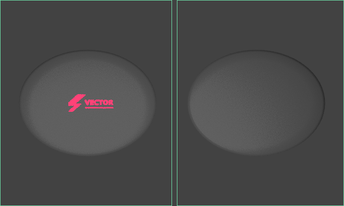
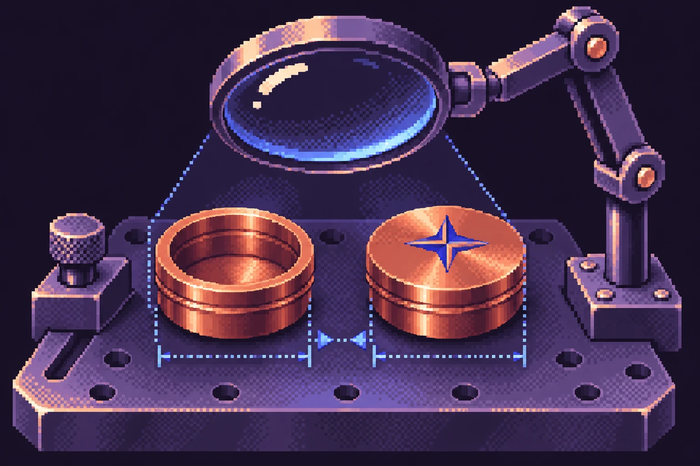

<div align="center">


<p><a href="README.md"></a> </p>

<p><strong>Редактируйте открытую сцену Blender из Codex или Claude Code и проверяйте правки по рендерам и пиксельным сравнениям.</strong></p>

<p><a href="#install"></a> <a href="#demos"></a> <a href="#verification"></a></p>

</div>

<a id="install"></a>

## Установка

### 1. Установите зависимости

- **Blender 4.3+**. Скачайте и установите обычную версию для вашей системы. [Скачать Blender](https://www.blender.org/download/)
- **MCP-клиент**. Установите Codex CLI или Claude Code и войдите в аккаунт. Проверьте в терминале, что работает `codex --version` или `claude --version`. [Codex CLI](https://developers.openai.com/codex/cli/) · [Claude Code](https://code.claude.com/docs/en/setup)
- **Git и Python 3.11+**. Команды для вашей системы приведены ниже.

Перед установкой закройте Blender. Скрипт создаст локальное окружение Python, включит аддон, настроит его связь с сервером и зарегистрирует `foma-scene` в клиенте. В примерах указан Codex. Для Claude Code замените `--client codex` на `--client claude`. Можно указать и оба параметра.

### 2. Запустите установку для своей системы

[Linux](#install-linux) · [macOS](#install-macos) · [Windows](#install-windows)

<a id="install-linux"></a>

<details>
<summary><strong>Linux</strong> · Bash</summary>

На Ubuntu 24.04 или Debian 12+ установите Git, Python и поддержку виртуальных окружений. В других дистрибутивах используйте их менеджер пакетов.

```bash
sudo apt update
sudo apt install git python3 python3-venv
python3 --version
git clone https://github.com/msFoma/foma-scene.git
cd foma-scene
python3 scripts/setup_scene.py --client codex
```

Если Blender скачан архивом, распакуйте его и укажите полный путь к файлу `blender`. В примере архив распакован в `~/apps/blender`.

```bash
python3 scripts/setup_scene.py --client codex --blender "$HOME/apps/blender/blender"
```

</details>

<a id="install-macos"></a>

<details>
<summary><strong>macOS</strong> · Терминал</summary>

Переместите Blender.app в **Программы**. Если у вас установлен Homebrew, выполните `brew install git python`. Git и Python также можно установить с официальных сайтов. [Git](https://git-scm.com/downloads) · [Python](https://www.python.org/downloads/macos/)

```bash
python3 --version
git --version
git clone https://github.com/msFoma/foma-scene.git
cd foma-scene
python3 scripts/setup_scene.py --client codex
```

Если приложение лежит в другой папке или называется иначе, укажите путь к исполняемому файлу внутри приложения. Например, `--blender "/Applications/Blender LTS.app/Contents/MacOS/Blender"`.

</details>

<a id="install-windows"></a>

<details>
<summary><strong>Windows</strong> · PowerShell</summary>

Установите версии Blender и MCP-клиента для Windows. Если доступен WinGet, установите Git и Python командами:

```powershell
winget install --id Git.Git --exact
winget install --id Python.Python.3.12 --exact
```

Можно воспользоваться и официальными установщиками. При ручной установке Python включите лаунчер, если установщик предлагает такой вариант. [Git для Windows](https://git-scm.com/download/win) · [Python для Windows](https://www.python.org/downloads/windows/)

Откройте новое окно PowerShell, чтобы обновился PATH, и выполните:

```powershell
py -3 --version
git --version
git clone https://github.com/msFoma/foma-scene.git
Set-Location foma-scene
py -3 scripts/setup_scene.py --client codex
```

Если команда `py` недоступна, но `python --version` показывает 3.11 или новее, используйте `python`. Если скрипт не нашёл Blender, добавьте `--blender` и путь к вашему `blender.exe`. Например, `--blender "C:\Program Files\Blender Foundation\Blender 4.5\blender.exe"`.

</details>

### 3. Подключите Blender и проверьте связь

1. Откройте Blender. Наведите курсор на **3D Viewport**, нажмите **N**, откройте вкладку **Blender MCP** и нажмите **Connect**. Когда мост запустится, кнопка сменится на **Disconnect**.
2. Убедитесь, что сервер `foma-scene` есть в списке `codex mcp list` или `claude mcp list`. Затем начните новый сеанс в клиенте.
3. Выделите объект в Blender и попросите агента:

   > Через Foma Scene проверь выделенный объект и покажи снимок из окна 3D Viewport.

<details>
<summary>Если подключение не работает</summary>

- **Вкладки Blender MCP нет.** Перезапустите Blender и проверьте, что скрипт установил аддон в ту же версию программы. Найдите **Foma Scene · Blender MCP** в **Preferences → Add-ons**.
- **Команда клиента не найдена.** Откройте новый терминал и проверьте `codex --version` или `claude --version`. При запуске без `--client` скрипт выведет команды регистрации.
- **Сервер не видит Blender.** Запустите клиент и Blender в одной локальной среде. Для этой установки на Windows запускайте оба приложения в Windows. Убедитесь, что в боковой панели видна кнопка **Disconnect**. Если меняли токен или порт моста, закройте Blender и запустите установку ещё раз.

[Ручная установка и Streamable HTTP (EN)](docs/guide.md#manual-setup-and-local-http)

</details>

<a id="demos"></a>

## Демо


**Анимированная передача 3:1.** В пустой сцене попросите Foma Scene создать шестерни на 18, 30 и 54 зуба и показать рендер камеры. За один оборот входной шестерни выходная поворачивается на 120° в ту же сторону.

<details>
<summary>Проверка декали и пиксельные иллюстрации</summary>



Foma Scene нанёс логотип шириной **40 мм** на одну из двух крышек с общим материалом и сдвинул его на **3 мм** по локальной оси X. На соседней крышке и снизу изменилось **0 пикселей**.

 

</details>

<a id="verification"></a>

## Инструменты и проверки

Foma Scene поддерживает редактируемые декали, рендеры камер и снимки 3D Viewport, сравнение с референсами, операции совместимых аддонов, откат и проверку GLB повторным импортом.

[Справочник инструментов (EN)](docs/guide.md#tools-and-semantics) · [Навык для агентов (EN)](skills/blender-mcp/SKILL.md) · [Результаты тестов (EN)](docs/guide.md#verification-on-25-november-2026)
