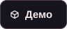
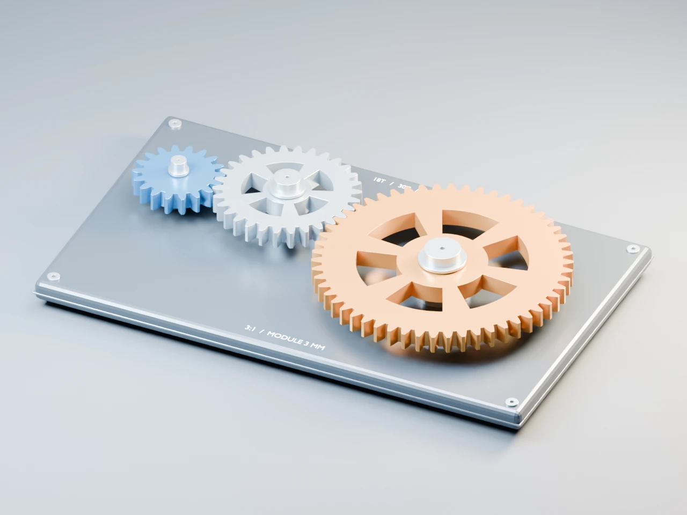

<div align="center">


<p><a href="README.md"></a> </p>

<p><strong>Blender MCP для работы с открытой сценой и проверки результата.</strong></p>

<p><a href="#install"></a> <a href="#demos"></a> <a href="#verification"></a></p>


</div>

## Возможности

| Открытая сцена Blender | Точечные правки |
| --- | --- |
| Проверяйте выделенный объект, получайте рендеры камер и снимки viewport. | Наносите и сдвигайте декали в миллиметрах, вызывайте операции аддонов и собирайте анимированные передачи. |
| **Проверка по кадрам** | **Восстановление и экспорт** |
| Сравнивайте сохранённые кадры до и после правки. Задавайте допуски для отдельных участков без повторного рендера. | Возвращайтесь к заданию после разрыва связи, откатывайте недавние правки и проверяйте GLB повторным импортом. |

<a id="demos"></a>
## Демо

### Анимированная передача 3:1



Механизм создан командой `create_gear_train` и отрендерен через `observe`. При повторном открытии сцены проверили, что за один оборот входной шестерни выходная поворачивается на **120° в ту же сторону**.

<details>
<summary>Посмотреть проверку точечной правки</summary>


Две крышки использовали общий материал. Foma Scene нанёс на одну крышку логотип шириной **40 мм** и сдвинул его на **3 мм** по локальной оси X. На соседней крышке и снизу изменилось **0 пикселей**. Карту вернул `verify_edit` из уже полученных кадров.

</details>

<a id="install"></a>
## Установка

Понадобятся **Python 3.11+** и **Blender 4.3+**. Из корня проекта установите MCP-сервер и соберите ZIP аддона.

```sh
python -m pip install -e .
mkdir -p work
python -m zipfile -c work/blender-bridge.zip blender_bridge
```

1. В Blender выберите **Edit → Preferences → Add-ons → Install from Disk**, откройте `work/blender-bridge.zip` и включите **Foma Scene · Blender MCP**.
2. Укажите токен моста длиной от 16 символов в настройках аддона. Откройте вкладку **Blender MCP** в боковой панели 3D Viewport и нажмите **Connect**.
3. Задайте тот же `BLENDER_MCP_TOKEN` в терминале, из которого запускается внешний MCP-сервер. Храните токен в локальном окружении.

```sh
python -m blender_mcp.server --transport streamable-http --port 8766
```

Добавьте запущенный локальный сервер в нужный клиент.

```sh
claude mcp add --transport http blender http://127.0.0.1:8766/mcp
codex mcp add blender --url http://127.0.0.1:8766/mcp
```

[Подключение по stdio, порты и токен (EN)](docs/guide.md#connect-an-open-blender-session) · [Справочник инструментов (EN)](docs/guide.md#tools-and-semantics)

### Первый запрос

Откройте пустую сцену и используйте навык [`blender-mcp`](skills/blender-mcp/SKILL.md) в Codex или Claude Code.

> Через Blender MCP создай передачу из шестерён на 18, 30 и 54 зуба. Укажи передаточное отношение и покажи рендер камеры.

`inspect_scene` даст токен сцены, `create_gear_train` соберёт механизм, а `observe` вернёт рендер из Blender.

<a id="verification"></a>
## Проверки

| Что проверили | Результат |
| --- | --- |
| Версии Blender | Приёмка прошла на **4.3.2**, **4.5.5 LTS** и **5.2.3 LTS**, включая GUI на 5.2.3. |
| MCP | Один каталог инструментов вернул изображения камер через **stdio** и **Streamable HTTP**. |
| Скорость сравнения | На сцене с крышками две карты изменений пришли за **133 мс**. Повторный рендер тех же ракурсов занял **2,52 с**. |
| Большая сцена | Медиана запроса подробной страницы из 200 экземпляров на сцене из 5 000 объектов сократилась с **2,10 с до 94 мс**. |
| Клиенты | Codex app-server получил PNG из Blender, Claude Code подключился к MCP. Для модельных прогонов остаётся войти в оба клиента. |

```sh
python tests/smoke.py
python tests/scalability.py
```

[Команды полной приёмки (EN)](docs/guide.md#run-the-wider-acceptance-check) · [Результаты тестов (EN)](docs/guide.md#verification-on-25-november-2026)
